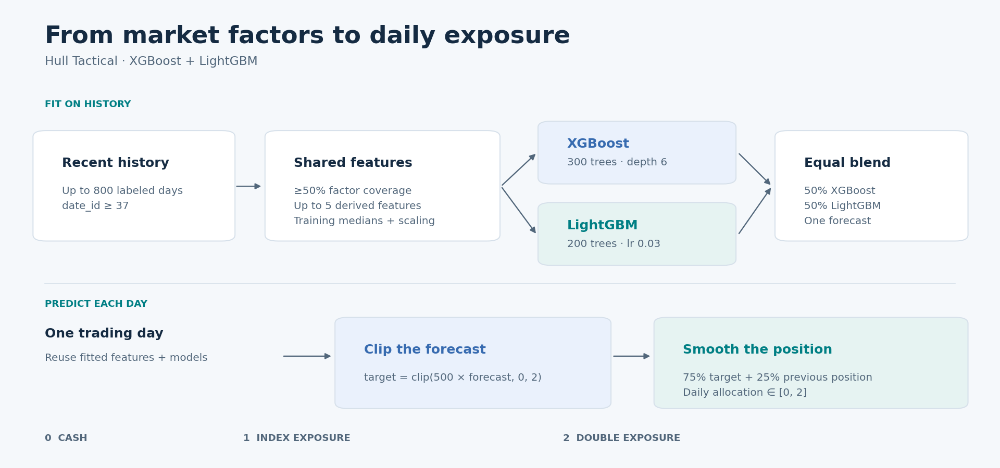
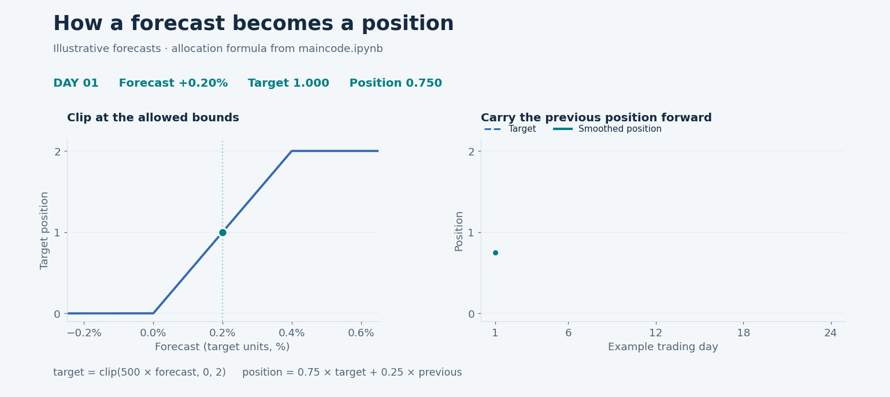

# Hull Tactical – Market Prediction

**Silver Medal source code · XGBoost + LightGBM**

Predict S&P 500 excess returns, combine two regressors, and turn each forecast into a daily index position.

[Competition](https://www.kaggle.com/competitions/hull-tactical-market-prediction) · [Data](https://www.kaggle.com/competitions/hull-tactical-market-prediction/data) · [Rules](https://www.kaggle.com/competitions/hull-tactical-market-prediction/rules) · [Leaderboard](https://www.kaggle.com/competitions/hull-tactical-market-prediction/leaderboard) · **[Open notebook →](maincode.ipynb)**

[Overview](#overview) · [Competition brief](#competition-brief) · [Method](#method) · [Allocation](#allocation) · [Run](#run)

## Overview

The notebook fits both models on recent history, then responds to one trading day at a time. Training medians, scaling, and model weights are reused throughout inference. The previous position carries into the next decision.

[](assets/overview.png)

## Competition brief

Hull Tactical asks participants to outperform the S&P 500 while keeping strategy volatility within 120% of market volatility.

| Item | Official specification |
| --- | --- |
| Prediction | One S&P 500 allocation per trading day, in `[0, 2]` |
| Position meaning | `0` holds cash · `1` holds the index · `2` doubles index exposure |
| Evaluation | Adjusted Sharpe ratio, with penalties for excess volatility and market underperformance |
| Submission | A Kaggle Notebook using the supplied evaluation API, which serves test data chronologically |
| Runtime | Up to 8 hours on CPU or GPU during training, extended to 9 hours for forecasting |
| Internet | Disabled during submission runs |

Training submissions closed on December 15, 2025. The forecasting phase ended on June 25, 2026. [Official overview and evaluation](https://www.kaggle.com/competitions/hull-tactical-market-prediction/overview)

<details>
<summary><strong>Data and submission requirements</strong></summary>

| Input | Use in this notebook |
| --- | --- |
| `train.csv` | Historical factors and `market_forward_excess_returns` labels |
| `test.csv` | Example trading days for the local inference gateway |
| `kaggle_evaluation/` | Competition-provided inference server and gateway |
| `forward_returns`, `risk_free_rate` | Optional holdout return calculation |

The notebook trains on the supplied `market_forward_excess_returns` target. Each API response is a single floating-point allocation. The final cell starts the local gateway interactively and the inference server during a competition rerun.

Download competition files through your Kaggle account after accepting the competition rules. [Data access](https://www.kaggle.com/competitions/hull-tactical-market-prediction/data), [official rules](https://www.kaggle.com/competitions/hull-tactical-market-prediction/rules)

</details>

## Method

Training rows are sorted by `date_id`, filtered to `date_id >= 37` with a finite target, and limited to the most recent 800 observations. The models receive the same factor columns, derived features, and standardized values.

| Component | Configuration |
| --- | --- |
| Factor selection | Numbered `D/E/I/M/P/S/V` and `MOM` columns with at least 50% finite coverage in the training window |
| Derived features | Up to five differences, ratios, and cross-products |
| XGBoost | 300 trees · depth 6 · learning rate 0.05 |
| LightGBM | 200 trees · learning rate 0.03 |
| Ensemble | 50% XGBoost + 50% LightGBM |
| Fitting | One fit for daily inference · seed 42 · one CPU thread per model |

<details>
<summary><strong>Inspect features and fitted preprocessing</strong></summary>

| Feature | Definition |
| --- | --- |
| `U1` | `I2 - I1` |
| `U2` | `M11 / ((I2 + I7 + I9) / 3)` |
| `V1_S1` | `V1 * S1` |
| `M11_V1` | `M11 * V1` |
| `I9_S1` | `I9 * S1` |

Each derived feature is included when its source factors survive selection. Interactions are calculated from observed inputs. Infinite values and undefined ratios become missing values.

Within the fitting window, raw interest-rate columns (`I*`) are forward-filled and then backward-filled. Remaining gaps use training medians, with zero as the fallback for a feature with no finite values. At inference, missing inputs use those fitted medians. `StandardScaler` is fitted on training rows and reused for each test day.

</details>

## Allocation

The starting position is zero. The daily forecast is the mean of the two model predictions.

```python
forecast = (xgb_prediction + lgb_prediction) / 2
target_position = clip(500 * forecast, 0, 2)
position = 0.75 * target_position + 0.25 * previous_position
```



*Illustrative forecasts evaluated with the notebook's allocation formula.*

<details>
<summary><strong>Follow the first three example decisions</strong></summary>

| Day | Mean forecast | Target position | Previous position | New position |
| --- | ---: | ---: | ---: | ---: |
| 1 | 0.002 | 1.000 | 0.000 | 0.750 |
| 2 | 0.004 | 2.000 | 0.750 | 1.688 |
| 3 | −0.001 | 0.000 | 1.688 | 0.422 |

These are the first three inputs in the animation. Clipping bounds the target to `[0, 2]`. Smoothing assigns 75% weight to the new target and 25% to the previous position. Repeated requests for the same day return the existing position.

</details>

## Run

1. Download the notebook and import it into a Kaggle Code session. [maincode.ipynb](maincode.ipynb)
2. Attach the competition data and its `kaggle_evaluation` directory. Select Python with a CPU runtime and disable internet access. [Competition data](https://www.kaggle.com/competitions/hull-tactical-market-prediction/data)
3. Run all five cells. The local gateway sends example test days to `MarketStrategy.predict`. Kaggle reruns use the same method through `DefaultInferenceServer`.

The notebook detects the usual Kaggle data mount paths. Set `HULL_DATA_DIR` for a custom location. The modeling library versions used for local validation are recorded in the dependency file. [requirements.txt](requirements.txt)

<details>
<summary><strong>Run a chronological holdout</strong></summary>

Set the first cell to

```python
HOLDOUT_DAYS = 120
```

The replay uses a preceding training window of up to 800 rows, leaves a one-row gap, then processes the last 120 labeled days in order. It calculates daily returns as

```python
strategy_return = risk_free_rate + position * (forward_returns - risk_free_rate)
```

The output reports compounded strategy and buy-and-hold returns before costs. After replay, a fresh strategy is fitted for the gateway. The default `HOLDOUT_DAYS = 0` skips this step.

</details>

<details>
<summary><strong>Find the implementation</strong></summary>

| Notebook cell | Contents |
| --- | --- |
| 1 | Imports, data location, training and holdout settings |
| 2 | `market_factors` and `add_interactions` |
| 3 | `MarketStrategy` fitting, forecasting, and position state |
| 4 | Optional holdout replay and final fitting |
| 5 | Kaggle gateway and inference server |

```text
.
├── maincode.ipynb
├── requirements.txt
├── README.md
└── assets/
    ├── overview.png
    └── allocation.gif
```

</details>
